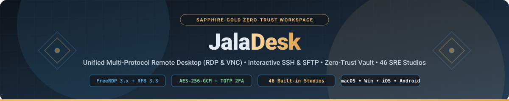
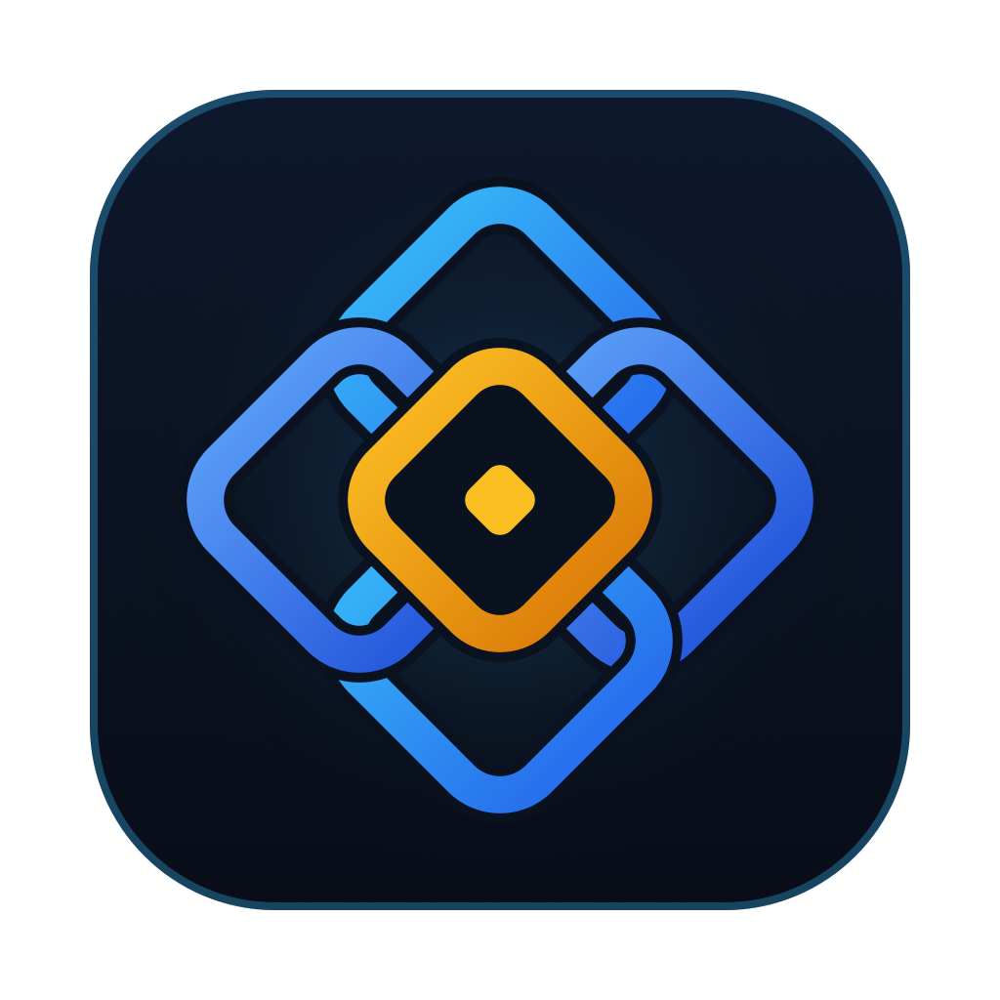
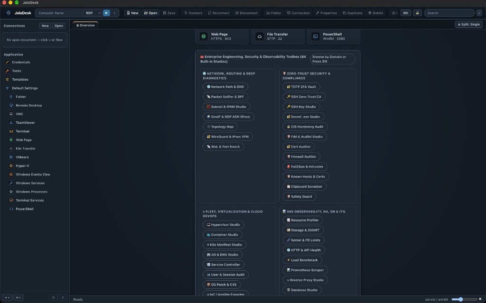
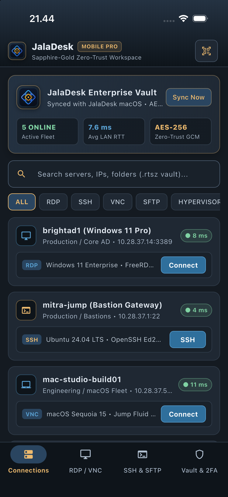
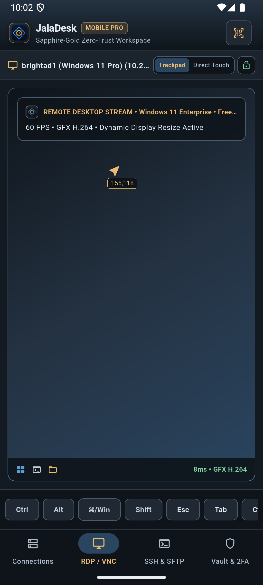
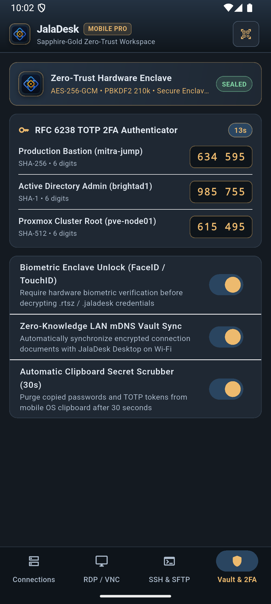
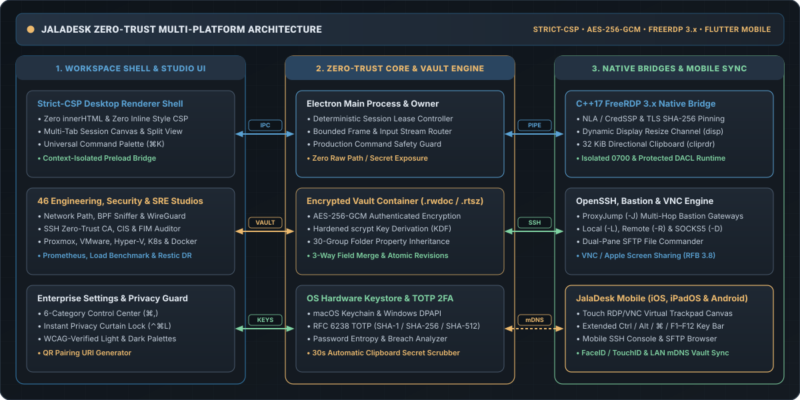

<div align="center">

<!-- Sapphire-Gold Hero Banner (Hosted locally in docs/assets for 100% reliability) -->


<br/><br/>



<br/><br/>

<!-- Badges -->
[](https://github.com/ribato22/jaladesk)
[](./mobile)
[](./native/rdp)
[](#46-built-in-engineering-security--sre-studios)
[](#getting-started)
[](./LICENSE)

<br/>

[**Overview**](#overview) •
[**Visual Showcase**](#visual-showcase) •
[**System Architecture**](#system-architecture) •
[**46 Built-in Studios**](#46-built-in-engineering-security--sre-studios) •
[**Mobile Companion**](#jaladesk-mobile-ios-ipados--android) •
[**Security & Zero-Trust**](#zero-trust-security--cryptographic-architecture) •
[**Getting Started**](#getting-started) •
[**License**](#license)

</div>

---

## Overview

**JalaDesk** (*Simpul Jala Emas-Safir*) is an enterprise-grade, multi-protocol remote desktop, infrastructure management, and zero-trust operations platform built for System Administrators, Site Reliability Engineers (SREs), DevSecOps teams, and Cloud Architects.

**JalaDesk** unifies remote desktop streaming, interactive terminal & file transfer workflows, hardware-backed credential security, and deep infrastructure observability into a single cohesive workspace across **macOS, Windows, iOS, iPadOS, and Android**:

- 🖥️ **Native Multi-Protocol Remote Desktop (`RDP` & `VNC`)**: Powered by a custom **C++17 FreeRDP 3.x / OpenSSL 3.x** native helper bridge (`native/rdp/`) featuring Network Level Authentication (`NLA / CredSSP`), TLS certificate SHA-256 pinning, dynamic display channel (`disp`) live resolution resizing without reconnect, high-precision vertical/horizontal scroll & trackpad pinch-zoom forwarding, opt-in 32 KiB directional UTF-8 clipboard (`cliprdr`), and macOS `⌘ Cmd ⇄ Ctrl` modifier remapping.
- ⚡ **Interactive SSH Terminal, Bastion Gateway & Dual-Pane SFTP**: Full VT100/xterm interactive shell, `ProxyJump` (`ssh -J`) multi-hop bastion chaining, Local (`-L`) / Remote (`-R`) / Dynamic SOCKS5 (`-D`) port-forwarding studio, multi-host Broadcast Input, and a dual-pane SFTP file commander.
- 🔐 **Zero-Trust Encrypted Vault (`.rwdoc` / `.rtsz` / `.jaladesk`)**: Authenticated `AES-256-GCM` document encryption with `scrypt` key derivation, 30-group folder-to-connection hierarchical inheritance, 3-way field-level conflict merge, OS Keychain integration (`macOS Keychain` / `Windows DPAPI`), and a built-in **RFC 6238 TOTP 2FA Authenticator** (`SHA-1` / `SHA-256` / `SHA-512`).
- 🛠️ **46 Built-in Engineering, Security & SRE Studios**: Instant in-tab diagnostic and automation studios accessible via the **Command Palette (`⌘K`)** or **Overview Launchpad** across Network Routing, Zero-Trust Compliance, Virtualization/Cloud DevOps, and SRE Observability.
- 📱 **JalaDesk Mobile (`iOS`, `iPadOS` & `Android`)**: Companion Flutter application featuring the **Sapphire-Gold NOC Midnight** identity, **Fluid Touch RDP/VNC Canvas** (precision virtual trackpad + direct touch + extended `Ctrl`/`Alt`/`⌘`/`F1–F12` modifier strip), **Mobile SSH & SFTP Console**, hardware biometric lock (`FaceID` / `TouchID`), and **Zero-Trust QR Vault Pairing** (`jaladesk://pair?v=1&...`).

---

## Visual Showcase

### 🖥️ JalaDesk Desktop Workspace (`macOS` & `Windows`)

<div align="center">
  
  <p><em>JalaDesk Desktop — Compact Icon Toolbar with Tooltips, Hierarchical Connection Sidebar, Quick-Connect Bar, and Built-in Engineering, Security & SRE Studios.</em></p>
</div>

### 📱 JalaDesk Mobile Companion (`iOS Simulator` & `Android Emulator`)

<div align="center">
  <table>
    <tr>
      <td align="center" width="33%">
        
        <br/>
        <strong>Connections & Zero-Trust Fleet Vault</strong><br/>
        <sub>Live LAN latency telemetry, protocol filters (RDP / SSH / VNC / SFTP / Hypervisor) & instant QR Desktop Sync</sub>
      </td>
      <td align="center" width="33%">
        
        <br/>
        <strong>Touch RDP / VNC Canvas</strong><br/>
        <sub>Precision virtual trackpad vs. Direct Touch toggle, live coordinate HUD, pinch-to-zoom & sticky modifier bar</sub>
      </td>
      <td align="center" width="33%">
        
        <br/>
        <strong>Hardware Enclave & TOTP 2FA</strong><br/>
        <sub>Sealed AES-256-GCM enclave status, tap-to-copy RFC 6238 2FA codes, FaceID/TouchID lock & 30s clipboard scrubber</sub>
      </td>
    </tr>
  </table>
</div>

---

## System Architecture

<div align="center">
  
</div>

---

## 46 Built-in Engineering, Security & SRE Studios

Every studio is accessible directly inside the workspace via the **Command Palette (`⌘K`)**, the **Overview Launchpad**, or the **Browse by Domain** selector:

### 🌐 1. Network, Routing & Deep Diagnostics
| Studio | Key Capabilities |
| :--- | :--- |
| **Network Path & DNS Studio** | Multi-probe `ping`, hop-by-hop `traceroute` / `mtr`, and authoritative `dig` DNS record inspection (`A`, `AAAA`, `MX`, `TXT`, `SRV`, `CAA`). |
| **Packet Sniffer & BPF Studio** | Live `tcpdump` packet capture builder with Berkeley Packet Filter (`BPF`) syntax generator and protocol breakdown. |
| **Subnet & IPAM Calculator** | IPv4/IPv6 CIDR subnet splitter, supernet aggregator, usable host range calculator, and VLAN IPAM planner. |
| **GeoIP & BGP ASN Whois** | Autonomous System Number (`ASN`) ownership lookup, BGP prefix routing inspection, and geolocation telemetry. |
| **Live Topology Map** | Interactive dependency graph of bastions, hypervisors, database nodes, and downstream workloads. |
| **WireGuard & IPsec VPN Studio** | Keypair generator, peer tunnel configuration builder, and live handshake/transfer health inspector. |
| **Wake-on-LAN & Port Knocking** | Magic Packet (`UDP 9`) broadcaster and cryptographic multi-port knock sequence dispatcher. |

### 🛡️ 2. Zero-Trust Security & Compliance
| Studio | Key Capabilities |
| :--- | :--- |
| **TOTP 2FA Vault** | RFC 6238 hardware-backed `SHA-1`, `SHA-256`, and `SHA-512` 6-digit authenticator with countdown telemetry. |
| **SSH Zero-Trust CA Studio** | Short-lived OpenSSH user & host certificate authority (`ssh-keygen -s`) workflow with principal scoping. |
| **SSH Key Studio** | `Ed25519`, `ECDSA-P384`, and `RSA-4096` keypair generator, fingerprint auditor, and `authorized_keys` deployer. |
| **Secret `.env` Sealer** | Client-side `AES-256-GCM` encryption and sealing for production `.env` and secret manifest files. |
| **CIS Hardening Benchmark Auditor** | Automated OS security posture checks mapped against CIS Level 1 & Level 2 server benchmarks. |
| **FIM & `auditd` Studio** | File Integrity Monitoring (`SHA-256` baseline verification) on `/etc/passwd`, `/etc/sudoers`, and `/etc/ssh/sshd_config`. |
| **TLS Certificate Chain Auditor** | X.509 certificate expiration inspector, SAN verifier, cipher suite grader, and SHA-256 pin extractor. |
| **Firewall Auditor** | Unified rule inspection and generator for Linux `nftables` / `ufw` / `iptables` and macOS/BSD `pf`. |
| **Fail2Ban & Intrusion Studio** | SSH brute-force jail monitor, offending IP ban/unban controller, and auth log anomaly analyzer. |
| **Known Hosts & Certs Manager** | SSH `known_hosts` host-key rotation detector and anti-MITM fingerprint pinning registry. |
| **Clipboard Secret Scrubber** | Automatic TTL countdown scrubber that purges copied passwords, private keys, and tokens from the OS clipboard. |
| **Production Safety Guard** | Real-time command interceptor blocking destructive commands (`rm -rf /`, `mkfs`, `DROP DATABASE`, `shutdown`) on production hosts. |

### ☁️ 3. Fleet, Virtualization & Cloud DevOps
| Studio | Key Capabilities |
| :--- | :--- |
| **Hypervisor Studio** | Unified VM & container lifecycle control across **Proxmox VE (`qm`/`pct`)**, **VMware ESXi**, and **Windows Hyper-V**. |
| **Container Studio** | Docker & Compose container inspection, live resource stats, log streaming, and image vulnerability pruning. |
| **Kubernetes Manifest & Pod Studio** | `kubectl` pod health inspector, deployment rollout controller, and YAML resource quota validator. |
| **Active Directory & DNS Studio** | Windows Server AD user/group/GPO query builder, Kerberos ticket inspector, and PowerShell WinRM runner. |
| **Service Controller** | Cross-platform daemon management for Linux `systemd` (`systemctl`) and Windows Services (`sc.exe` / `Get-Service`). |
| **User & Session Audit** | Live logged-in session tracker (`who`, `w`, `last`, `quser`, `qwinsta`) with orphan session termination. |
| **OS Patch & CVE Scanner** | Unattended security update auditor across `apt` (Debian/Ubuntu), `dnf` (RHEL/Rocky), and Windows Update. |
| **IaC / Ansible Inventory Exporter** | One-click export of JalaDesk connection folders into structured Ansible (`hosts.yml`), Terraform, or `~/.ssh/config`. |

### 📊 4. SRE Observability, HA, DR & ITIL
| Studio | Key Capabilities |
| :--- | :--- |
| **Resource Profiler** | Real-time CPU load average, memory pressure, swap thrashing, and top-process (`ps`/`pidstat`) telemetry. |
| **Storage & SMART Health** | Disk partition utilization (`df -h`), inode exhaustion checker, and NVMe/SATA `smartctl` health analyzer. |
| **Kernel & FD Limits Studio** | Linux `sysctl` network/memory tuning (`somaxconn`, `BBR`, `vm.swappiness`) and open file descriptor (`ulimit -n`) auditor. |
| **HTTP & API Health Probe** | Multi-endpoint REST/GraphQL synthetic probe measuring DNS, TCP, TLS handshake, TTFB, and status code SLAs. |
| **Load Benchmark Studio** | Controlled HTTP concurrency, RPS throughput, and `p50` / `p95` / `p99` tail-latency stress profiler. |
| **Prometheus Metrics Scraper** | OpenMetrics `/metrics` endpoint parser with live gauge, counter, and histogram inspection. |
| **Reverse Proxy Studio** | Zero-downtime configuration generator and reload tester for **Nginx**, **Caddy**, **HAProxy**, and **Traefik**. |
| **Database Studio** | Connection pool, slow-query, and replication lag inspector for **PostgreSQL**, **MySQL/MariaDB**, and **Redis**. |
| **Log Tail & Regex Alert Studio** | Live `journalctl` / `/var/log` streaming filter with custom regex anomaly highlighting. |
| **Network Speed & iPerf3 Studio** | Point-to-point TCP/UDP bandwidth, jitter, and packet-loss throughput profiler. |
| **Cron & Systemd Timer Studio** | Visual cron expression validator, next-run simulator, and `systemd` `.timer`/`.service` unit generator. |
| **Backup & Restic DR Studio** | Deduplicated encrypted snapshot planner (`restic` / `borg` / `rsync`), retention policy builder, and restore drill checklist. |
| **Incident Runbook & Postmortem** | ITIL/SRE incident severity classifier, live timeline logger, and blameless Markdown postmortem generator. |
| **SSL/TLS CSR & SAN Studio** | OpenSSL `req` command and config generator for multi-domain Subject Alternative Name (`SAN`) CSRs. |
| **Port & Socket Conflict Resolver** | Instant `lsof -i` / `ss -tulpn` port-binding inspector to identify and resolve address-in-use conflicts. |
| **Cloud Cost FinOps Estimator** | Compute, storage, and egress cost comparison across on-premise bare metal, AWS, GCP, and Hetzner/OVH. |

---

## JalaDesk Mobile (`iOS`, `iPadOS` & `Android`)

Located in [`mobile/`](./mobile), the **JalaDesk Mobile Companion** brings desktop-class remote operations to smartphones and tablets with a unified **Sapphire-Gold NOC Midnight (`JalaPalette`)** interface:

1. **Connections & Fleet Telemetry Tab**:
   - Real-time active fleet count, average LAN RTT (`ms`), and `AES-256-GCM` vault status banner.
   - Instant search and protocol filter strip (`ALL`, `RDP`, `SSH`, `VNC`, `SFTP`, `HYPERVISOR`).
   - One-tap **Zero-Trust QR / URI Pairing** (`jaladesk://pair?v=1&relay=lan-direct&...`) with JalaDesk Desktop.
2. **Fluid Touch RDP / VNC Canvas Tab**:
   - Instant toggle between **Precision Virtual Trackpad Mode** (relative cursor movement with live `x,y` coordinate HUD) and **Direct Touch Mode** (absolute tap-to-click).
   - Interactive pinch-to-zoom (`1.0x` – `4.0x` via `InteractiveViewer`), View-Only safety lock, and a scrollable sticky modifier & function key bar (`Ctrl`, `Alt`, `⌘/Win`, `Shift`, `Esc`, `Tab`, `Ctrl+Alt+Del`, `Win+D`, arrow keys, `F1`–`F12`).
3. **Interactive Mobile SSH & Dual-Pane SFTP Tab**:
   - Interactive monospace SSH console with quick-action command chips (`uptime`, `docker ps`, `kubectl get pods`, `uname -a`, `df -h`, `clear`) and one-tap switch to the **Mobile SFTP File Browser**.
4. **Zero-Trust Hardware Enclave & RFC 6238 2FA Tab**:
   - Sealed enclave banner, live 30-second countdown TOTP authenticator with tap-to-copy tokens, **Biometric Enclave Unlock (`FaceID` / `TouchID`)**, **Zero-Knowledge LAN mDNS Vault Sync**, and **30-second Automatic Clipboard Secret Scrubber**.

---

## Zero-Trust Security & Cryptographic Architecture

JalaDesk is engineered from the ground up with strict security boundaries verified by automated tests:

- **Authenticated Document Encryption (`src/documents/`)**: Connection documents (`.rwdoc` / `.rtsz` / `.jaladesk`) are encrypted at rest using **`AES-256-GCM`** with **`scrypt`** key derivation, random per-save salts/nonces, and atomic write-replace file operations.
- **Zero Renderer Secret Exposure (`src/credentials/`)**: Passwords, private keys, and TOTP seeds remain isolated in the main/owner process. Renderer UI components receive only opaque credential references and masked metadata—never raw secret values or raw filesystem paths.
- **Strict Content Security Policy (`src/desktop/`)**: All HTML views enforce `default-src 'none'; script-src 'self'; style-src 'self'; img-src 'self' data:; connect-src 'none'`. Zero `innerHTML` or inline style injections are permitted anywhere in the codebase.
- **Isolated Native Runtime Directories (`native/rdp/`)**: Every FreeRDP helper session executes inside an isolated runtime directory enforced with POSIX `0700` permissions on macOS/Linux and Protected DACL (`TokenUser` ownership) plus Job Object process containment on Windows.

---

## Keyboard Shortcuts & Productivity

| Shortcut | Action |
| :--- | :--- |
| <kbd>⌘ Cmd</kbd> + <kbd>K</kbd> | Open **Universal Command Palette** (Search hosts, actions & all 46 Studios) |
| <kbd>⌘ Cmd</kbd> + <kbd>,</kbd> | Open **JalaDesk Enterprise Settings & Preferences Suite** (6 Categories) |
| <kbd>⌃ Ctrl</kbd> + <kbd>⌘ Cmd</kbd> + <kbd>L</kbd> | Engage **Zero-Trust Privacy Curtain Lock** (Instant screen & session blur) |
| <kbd>⌘ Cmd</kbd> + <kbd>N</kbd> / <kbd>⌘ Cmd</kbd> + <kbd>O</kbd> | Create New Encrypted Document / Open Existing `.rwdoc` or `.rtsz` Vault |
| <kbd>⌘ Cmd</kbd> + <kbd>S</kbd> | Save Encrypted Document Revision |
| <kbd>⌘ Cmd</kbd> + <kbd>1</kbd> … <kbd>9</kbd> | Switch Directly to Open Session or Studio Tab `1`–`9` |

---

## Repository Structure

```text
.
├── src/
│   ├── credentials/       # Zero-trust credential vault, password analyzer & RFC 6238 TOTP engine
│   ├── documents/         # AES-256-GCM encrypted container, 3-way merge, 30-group inheritance & templates
│   ├── protocols/rdp/     # RDP owner lifecycle, wire framing, directional clipboard & profile lease
│   └── desktop/           # Electron main process, strict-CSP renderer, 6-tab Settings & 46 studios
├── native/
│   ├── rdp/               # C++17 FreeRDP 3.x bridge, display/clipboard channels & DACL/0700 guard
│   └── test-server/       # Loopback FreeRDP test server for deterministic end-to-end verification
├── mobile/                # JalaDesk Mobile Companion (Flutter 3.x for iOS, iPadOS & Android)
│   ├── lib/main.dart      # Sapphire-Gold UI, Touch RDP/VNC canvas, SSH/SFTP console & TOTP 2FA vault
│   ├── ios/               # Xcode iOS / iPadOS runner (Deployment Target iOS 16.0+)
│   ├── android/           # Gradle Kotlin Android runner
│   └── test/              # Automated Flutter widget tests (verified at 320x680 & 360x780 viewports)
├── docs/assets/           # Brand logo, architecture SVG & desktop/mobile showcase screenshots
├── scripts/               # Build, native bootstrap, packaging & verification scripts
└── tests/                 # 1,428 automated Node.js, Electron, CSP, WCAG theme & security tests
```

---

## Getting Started

### 1. Desktop Suite (`macOS` & `Windows`)

```bash
# Clone the repository
git clone https://github.com/ribato22/jaladesk.git
cd jaladesk

# Install dependencies
npm ci

# Compile TypeScript & desktop assets
npm run build

# Run the complete automated verification suite (1,428 tests)
npm test

# Launch JalaDesk Desktop
npm start
```

### 2. Mobile Companion (`iOS`, `iPadOS` & `Android`)

```bash
cd mobile

# Fetch Flutter packages & run static analysis
flutter pub get
dart analyze lib test

# Run automated viewport & interaction widget tests (320x680 & 360x780)
flutter test

# Launch on iOS Simulator or Android Emulator
flutter run -d ios
flutter run -d android

# Build production release bundles for App Store & Google Play
flutter build ipa --release
flutter build appbundle --release
```

---

## License

**JalaDesk** is distributed under an **Open-Core Dual Licensing Model**:

- **Open-Source Core ([`Apache-2.0`](./LICENSE))**: The core desktop workspace, multi-protocol client engine (`src/protocols/`, `native/rdp/`), local encrypted vault (`src/documents/`, `src/credentials/`), 46 diagnostic studios (`src/desktop/`), and Flutter mobile companion (`mobile/`) are licensed under the **Apache License, Version 2.0**.
- **Enterprise Edition ([`docs/ENTERPRISE-LICENSE.md`](./docs/ENTERPRISE-LICENSE.md))**: Enterprise SSO/SAML/OIDC directory federation, Zero-Trust Team Vault Cloud Relay, and centralized compliance audit clusters are governed by the **JalaDesk Enterprise Commercial License**.

---

<div align="center">


</div>
