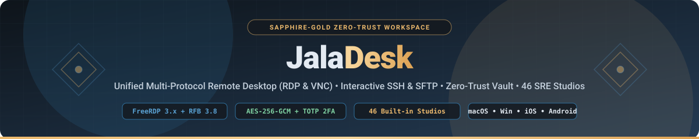
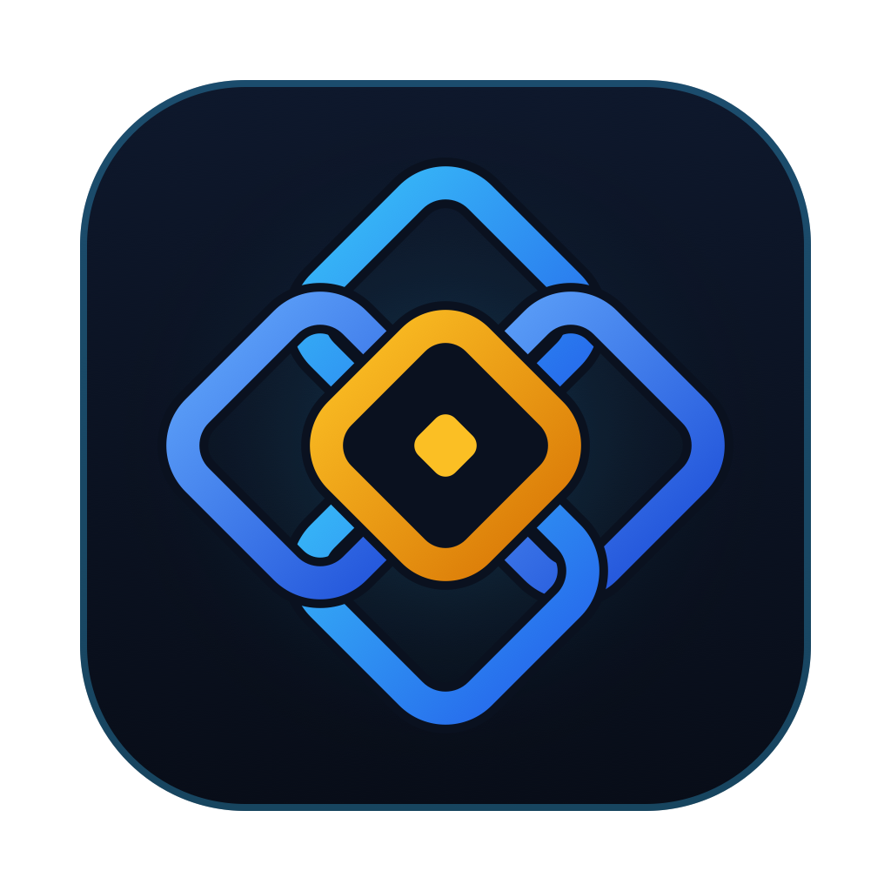
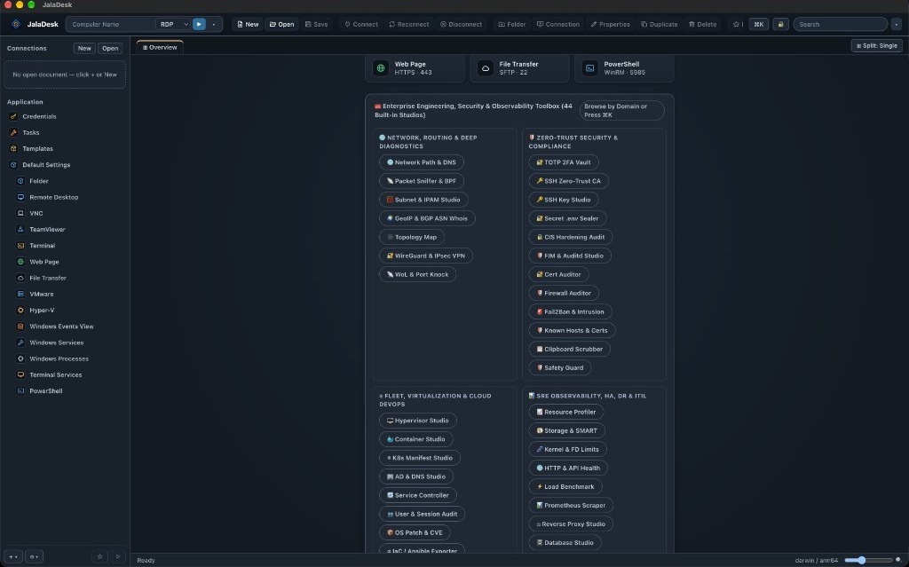
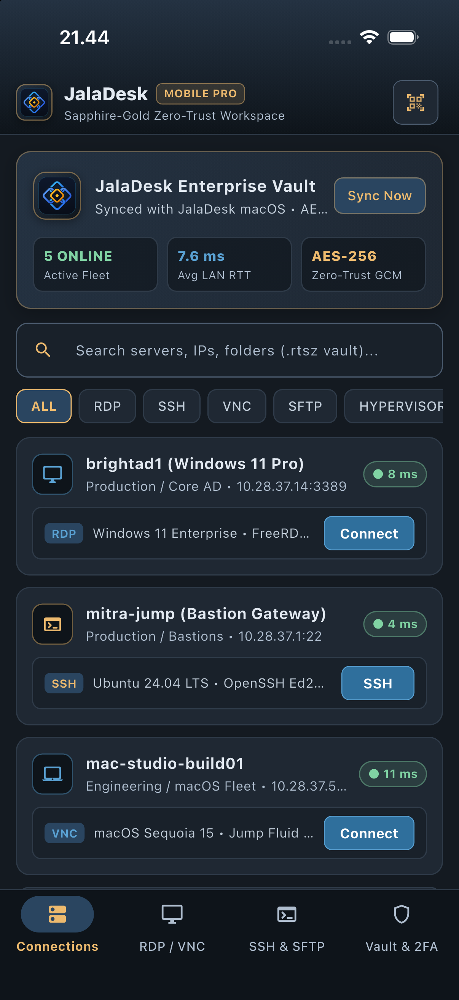
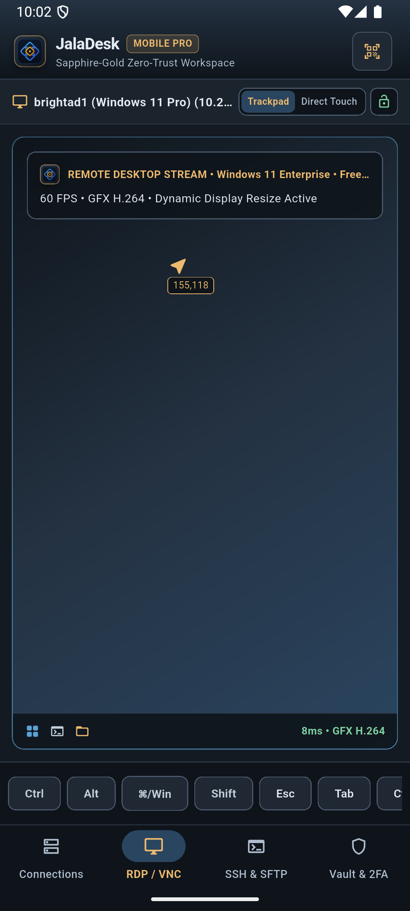
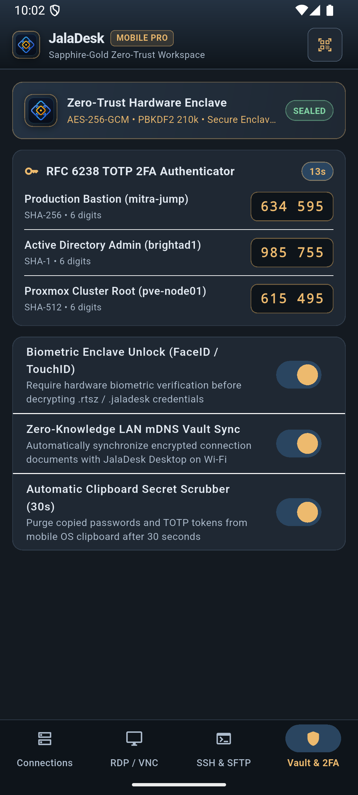
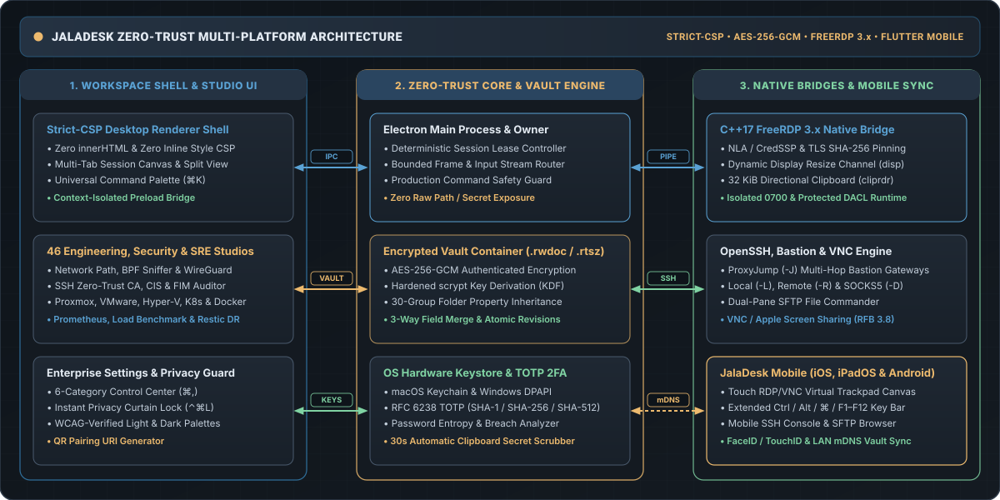

<div align="center">

<!-- Sapphire-Gold Hero Banner (Hosted locally in docs/assets for 100% reliability) -->


<br/><br/>



<br/><br/>

<!-- Badges -->
[](https://github.com/ribato22/jaladesk)
[](./mobile)
[](https://ribato22.github.io/jaladesk/app/)
[](./docs/GATEWAY.md)
[](./native/rdp)
[](#46-built-in-engineering-security--sre-studios)
[](./LICENSE)

<br/>

[**Overview**](#overview) •
[**4-Surface Ecosystem**](#4-surface-zero-trust-ecosystem) •
[**60s Gateway Deploy Pack**](#60-second-self-hosted-gateway-deploy-pack) •
[**Visual Showcase**](#visual-showcase) •
[**System Architecture**](#system-architecture) •
[**46 Built-in Studios**](#46-built-in-engineering-security--sre-studios) •
[**Security**](#zero-trust-security--cryptographic-architecture) •
[**Getting Started**](#getting-started) •
[**License**](#license)

</div>

---

## Overview

**JalaDesk** (*Simpul Jala Emas-Safir*) is an enterprise-grade, multi-protocol remote desktop, infrastructure management, and zero-trust operations platform built for System Administrators, Site Reliability Engineers (SREs), DevSecOps teams, and Cloud Architects.

**JalaDesk** unifies remote desktop streaming, interactive terminal & file transfer workflows, hardware-backed credential security, and deep infrastructure observability across **four seamlessly synchronized surfaces**:

- 🖥️ **Desktop Studio + 1-Click Web Bridge (`macOS` & `Windows`)**: Powered by a custom **C++17 FreeRDP 3.x / OpenSSL 3.x** native helper bridge (`native/rdp/`) featuring Network Level Authentication (`NLA / CredSSP`), TLS certificate SHA-256 pinning, dynamic display channel (`disp`) live resolution resizing without reconnect, high-precision scroll & pinch-zoom forwarding, opt-in 32 KiB directional UTF-8 clipboard (`cliprdr`), 46 built-in SRE/SecOps studios, and an embedded **1-Click Web Bridge** (`127.0.0.1:8443`) for instant browser pairing.
- 📱 **Mobile Companion (`iOS`, `iPadOS` & Android Foldable Flex Mode `v1.17.0`)**: Flutter application featuring the **Sapphire-Gold NOC Midnight** identity, **Android Foldable Flex Mode** (Tabletop Mini-Laptop & Book Mode adaptive decks), Jump Desktop-style Display Sizing & Full Screen, **Fluid Touch RDP/VNC Canvas**, **Mobile SSH & SFTP Console**, hardware biometric enclave (`FaceID` / `TouchID`), and **Zero-Trust QR Vault Pairing**.
- 🌐 **Zero-Knowledge Web PWA ([`ribato22.github.io/jaladesk/app/`](https://ribato22.github.io/jaladesk/app/))**: Client-side `AES-256-GCM` + `PBKDF2` (`310,000` iterations) browser vault with 1-Click Sign in with Google Drive `appDataFolder` sync, built-in RFC 6238 TOTP 2FA authenticator, OpenSSH `~/.ssh/config` import, interactive VT100 SSH/SFTP console, and live `JSR1` RDP/VNC canvas — zero plaintext secrets ever leave your browser RAM.
- 🚀 **Self-Hosted Zero-Trust Gateway (`JSR1`)**: Hardened, stateless multi-arch container (`ghcr.io/ribato22/jaladesk-gateway`, `linux/amd64` & `linux/arm64`) bridging browser `wss://` sessions to private LAN/VPC **FreeRDP 3**, **VNC**, **real SSH PTY**, and **streaming SFTP** with 64×64 dirty-rect PNG tiles, closed-loop ACK congestion control, 60-second single-use WebSocket tickets, and strict SSRF/CIDR target enforcement.

---

## 4-Surface Zero-Trust Ecosystem

| Surface | Platforms / Endpoint | Key Capabilities |
| :--- | :--- | :--- |
| **Desktop Studio + 1-Click Web Bridge** | macOS & Windows ([`src/desktop/`](./src/desktop), [`native/rdp/`](./native/rdp)) | Native FreeRDP 3 / VNC / SSH / SFTP, 46 SRE/SecOps Studios, OS Keychain/DPAPI, embedded `127.0.0.1:8443` Web Bridge with 6-digit pairing. |
| **Mobile Companion (`v1.17.0`)** | iOS, iPadOS & Android ([`mobile/`](./mobile)) | **Android Foldable Flex Mode** (Tabletop Mini-Laptop & Book Mode), virtual trackpad & direct touch canvas, SSH/SFTP, biometric enclave & RFC 6238 2FA. |
| **Zero-Knowledge Web PWA** | [`https://ribato22.github.io/jaladesk/app/`](https://ribato22.github.io/jaladesk/app/) ([`docs/app/`](./docs/app)) | Browser-side `AES-256-GCM` vault, 1-Click Google Drive AppData sync, `⌘K` Command Palette, multi-session tab bar, VT100 SSH/SFTP & live `JSR1` viewer. |
| **Self-Hosted Gateway (`JSR1`)** | Docker / Caddy / Cloudflare / Fly.io / Railway ([`docs/GATEWAY.md`](./docs/GATEWAY.md)) | Zero vault persistence, 256-bit token + 6-digit pairing, `Sec-WebSocket-Protocol: ticket.<TICKET>`, non-root `read_only` + `cap_drop: [ALL]` container. |

---

## 60-Second Self-Hosted Gateway Deploy Pack

Deploy a production HTTPS/WSS **JalaDesk Web Gateway** in under a minute and connect directly from [`https://ribato22.github.io/jaladesk/app/`](https://ribato22.github.io/jaladesk/app/) using the 6-digit `Pairing Code` printed in startup logs. Full configuration reference: **[`docs/GATEWAY.md`](./docs/GATEWAY.md)**.

### 1. VPS / Bare Metal — Docker + Caddy Auto-TLS 1.3 (`deploy/caddy/`)

Automatic Let's Encrypt HTTPS/WSS with HSTS & zero-trust headers; `jaladesk-gateway` stays private on an internal Docker bridge network with no exposed host port:

```bash
cp deploy/.env.example deploy/.env && sed -i.bak 's/gateway.example.com/gateway.yourdomain.com/' deploy/.env && \
  docker compose --env-file deploy/.env -f deploy/caddy/docker-compose.caddy.yml up -d && docker logs jaladesk-gateway
```

### 2. Zero-Port-Forwarding — Cloudflare Tunnel (`deploy/cloudflare/`)

**Zero open inbound firewall ports** behind NAT, homelabs, or private VPCs — point your Cloudflare Tunnel Public Hostname to `http://jaladesk-gateway:8443`:

```bash
cp deploy/.env.example deploy/.env && printf '\nCLOUDFLARE_TUNNEL_TOKEN=PASTE_TOKEN_HERE\n' >> deploy/.env && \
  docker compose --env-file deploy/.env -f deploy/cloudflare/docker-compose.cloudflared.yml up -d && docker logs jaladesk-gateway
```

### 3. Fly.io Managed Edge (`fly.gateway.toml`)

Global Anycast HTTPS with `/healthz` checks and scale-to-zero `suspend`:

```bash
fly launch --config fly.gateway.toml --copy-config --no-deploy && \
  fly secrets set JALADESK_GATEWAY_TOKEN="$(openssl rand -hex 32)" && \
  fly deploy --config fly.gateway.toml
```

### 4. Railway 1-Click Container (`railway.gateway.json`)

Uses [`Dockerfile.gateway`](./Dockerfile.gateway) with `/healthz` healthchecks and automatic restart-on-failure:

```bash
railway up --detach
```

---

## Visual Showcase

### 🖥️ JalaDesk Desktop Workspace (`macOS` & `Windows`)

<div align="center">
  
  <p><em>JalaDesk Desktop — Compact Icon Toolbar with Tooltips, Hierarchical Connection Sidebar, Quick-Connect Bar, and Built-in Engineering, Security & SRE Studios.</em></p>
</div>

### 📱 JalaDesk Mobile Companion (`iOS Simulator` & `Android Emulator`)

<div align="center">
  <table>
    <tr>
      <td align="center" width="33%">
        
        <br/>
        <strong>Connections & Zero-Trust Fleet Vault</strong><br/>
        <sub>Live LAN latency telemetry, protocol filters (RDP / SSH / VNC / SFTP / Hypervisor) & instant QR Desktop Sync</sub>
      </td>
      <td align="center" width="33%">
        
        <br/>
        <strong>Touch RDP / VNC Canvas & Flex Mode</strong><br/>
        <sub>Android Foldable Tabletop & Book Mode, virtual trackpad vs. Direct Touch toggle, live coordinate HUD & modifier bar</sub>
      </td>
      <td align="center" width="33%">
        
        <br/>
        <strong>Hardware Enclave & TOTP 2FA</strong><br/>
        <sub>Sealed AES-256-GCM enclave status, tap-to-copy RFC 6238 2FA codes, FaceID/TouchID lock & 30s clipboard scrubber</sub>
      </td>
    </tr>
  </table>
</div>

---

## System Architecture

<div align="center">
  
</div>

---

## 46 Built-in Engineering, Security & SRE Studios

Every studio is accessible directly inside the workspace via the **Command Palette (`⌘K`)**, the **Overview Launchpad**, or the **Browse by Domain** selector:

### 🌐 1. Network, Routing & Deep Diagnostics
| Studio | Key Capabilities |
| :--- | :--- |
| **Network Path & DNS Studio** | Multi-probe `ping`, hop-by-hop `traceroute` / `mtr`, and authoritative `dig` DNS record inspection (`A`, `AAAA`, `MX`, `TXT`, `SRV`, `CAA`). |
| **Packet Sniffer & BPF Studio** | Live `tcpdump` packet capture builder with Berkeley Packet Filter (`BPF`) syntax generator and protocol breakdown. |
| **Subnet & IPAM Calculator** | IPv4/IPv6 CIDR subnet splitter, supernet aggregator, usable host range calculator, and VLAN IPAM planner. |
| **GeoIP & BGP ASN Whois** | Autonomous System Number (`ASN`) ownership lookup, BGP prefix routing inspection, and geolocation telemetry. |
| **Live Topology Map** | Interactive dependency graph of bastions, hypervisors, database nodes, and downstream workloads. |
| **WireGuard & IPsec VPN Studio** | Keypair generator, peer tunnel configuration builder, and live handshake/transfer health inspector. |
| **Wake-on-LAN & Port Knocking** | Magic Packet (`UDP 9`) broadcaster and cryptographic multi-port knock sequence dispatcher. |

### 🛡️ 2. Zero-Trust Security & Compliance
| Studio | Key Capabilities |
| :--- | :--- |
| **TOTP 2FA Vault** | RFC 6238 hardware-backed `SHA-1`, `SHA-256`, and `SHA-512` 6-digit authenticator with countdown telemetry. |
| **SSH Zero-Trust CA Studio** | Short-lived OpenSSH user & host certificate authority (`ssh-keygen -s`) workflow with principal scoping. |
| **SSH Key Studio** | `Ed25519`, `ECDSA-P384`, and `RSA-4096` keypair generator, fingerprint auditor, and `authorized_keys` deployer. |
| **Secret `.env` Sealer** | Client-side `AES-256-GCM` encryption and sealing for production `.env` and secret manifest files. |
| **CIS Hardening Benchmark Auditor** | Automated OS security posture checks mapped against CIS Level 1 & Level 2 server benchmarks. |
| **FIM & `auditd` Studio** | File Integrity Monitoring (`SHA-256` baseline verification) on `/etc/passwd`, `/etc/sudoers`, and `/etc/ssh/sshd_config`. |
| **TLS Certificate Chain Auditor** | X.509 certificate expiration inspector, SAN verifier, cipher suite grader, and SHA-256 pin extractor. |
| **Firewall Auditor** | Unified rule inspection and generator for Linux `nftables` / `ufw` / `iptables` and macOS/BSD `pf`. |
| **Fail2Ban & Intrusion Studio** | SSH brute-force jail monitor, offending IP ban/unban controller, and auth log anomaly analyzer. |
| **Known Hosts & Certs Manager** | SSH `known_hosts` host-key rotation detector and anti-MITM fingerprint pinning registry. |
| **Clipboard Secret Scrubber** | Automatic TTL countdown scrubber that purges copied passwords, private keys, and tokens from the OS clipboard. |
| **Production Safety Guard** | Real-time command interceptor blocking destructive commands (`rm -rf /`, `mkfs`, `DROP DATABASE`, `shutdown`) on production hosts. |

### ☁️ 3. Fleet, Virtualization & Cloud DevOps
| Studio | Key Capabilities |
| :--- | :--- |
| **Hypervisor Studio** | Unified VM & container lifecycle control across **Proxmox VE (`qm`/`pct`)**, **VMware ESXi**, and **Windows Hyper-V**. |
| **Container Studio** | Docker & Compose container inspection, live resource stats, log streaming, and image vulnerability pruning. |
| **Kubernetes Manifest & Pod Studio** | `kubectl` pod health inspector, deployment rollout controller, and YAML resource quota validator. |
| **Active Directory & DNS Studio** | Windows Server AD user/group/GPO query builder, Kerberos ticket inspector, and PowerShell WinRM runner. |
| **Service Controller** | Cross-platform daemon management for Linux `systemd` (`systemctl`) and Windows Services (`sc.exe` / `Get-Service`). |
| **User & Session Audit** | Live logged-in session tracker (`who`, `w`, `last`, `quser`, `qwinsta`) with orphan session termination. |
| **OS Patch & CVE Scanner** | Unattended security update auditor across `apt` (Debian/Ubuntu), `dnf` (RHEL/Rocky), and Windows Update. |
| **IaC / Ansible Inventory Exporter** | One-click export of JalaDesk connection folders into structured Ansible (`hosts.yml`), Terraform, or `~/.ssh/config`. |

### 📊 4. SRE Observability, HA, DR & ITIL
| Studio | Key Capabilities |
| :--- | :--- |
| **Resource Profiler** | Real-time CPU load average, memory pressure, swap thrashing, and top-process (`ps`/`pidstat`) telemetry. |
| **Storage & SMART Health** | Disk partition utilization (`df -h`), inode exhaustion checker, and NVMe/SATA `smartctl` health analyzer. |
| **Kernel & FD Limits Studio** | Linux `sysctl` network/memory tuning (`somaxconn`, `BBR`, `vm.swappiness`) and open file descriptor (`ulimit -n`) auditor. |
| **HTTP & API Health Probe** | Multi-endpoint REST/GraphQL synthetic probe measuring DNS, TCP, TLS handshake, TTFB, and status code SLAs. |
| **Load Benchmark Studio** | Controlled HTTP concurrency, RPS throughput, and `p50` / `p95` / `p99` tail-latency stress profiler. |
| **Prometheus Metrics Scraper** | OpenMetrics `/metrics` endpoint parser with live gauge, counter, and histogram inspection. |
| **Reverse Proxy Studio** | Zero-downtime configuration generator and reload tester for **Nginx**, **Caddy**, **HAProxy**, and **Traefik**. |
| **Database Studio** | Connection pool, slow-query, and replication lag inspector for **PostgreSQL**, **MySQL/MariaDB**, and **Redis**. |
| **Log Tail & Regex Alert Studio** | Live `journalctl` / `/var/log` streaming filter with custom regex anomaly highlighting. |
| **Network Speed & iPerf3 Studio** | Point-to-point TCP/UDP bandwidth, jitter, and packet-loss throughput profiler. |
| **Cron & Systemd Timer Studio** | Visual cron expression validator, next-run simulator, and `systemd` `.timer`/`.service` unit generator. |
| **Backup & Restic DR Studio** | Deduplicated encrypted snapshot planner (`restic` / `borg` / `rsync`), retention policy builder, and restore drill checklist. |
| **Incident Runbook & Postmortem** | ITIL/SRE incident severity classifier, live timeline logger, and blameless Markdown postmortem generator. |
| **SSL/TLS CSR & SAN Studio** | OpenSSL `req` command and config generator for multi-domain Subject Alternative Name (`SAN`) CSRs. |
| **Port & Socket Conflict Resolver** | Instant `lsof -i` / `ss -tulpn` port-binding inspector to identify and resolve address-in-use conflicts. |
| **Cloud Cost FinOps Estimator** | Compute, storage, and egress cost comparison across on-premise bare metal, AWS, GCP, and Hetzner/OVH. |

---

## JalaDesk Mobile (`iOS`, `iPadOS` & Android Foldable Flex Mode `v1.17.0`)

Located in [`mobile/`](./mobile), the **JalaDesk Mobile Companion** brings desktop-class remote operations to phones, tablets, and foldables with a unified **Sapphire-Gold NOC Midnight (`JalaPalette`)** interface:

1. **Android Foldable Flex Mode (`v1.17.0`)**:
   - Automatic hinge-posture detection (`jala_foldable_posture.dart` & `jala_flex_decks.dart`) switching seamlessly into **Tabletop Mini-Laptop Mode** (top screen live RDP/SSH canvas, bottom deck interactive trackpad & tactile modifier keyboard) and **Book Mode** split workspace.
2. **Connections & Fleet Telemetry Tab**:
   - Real-time active fleet count, average LAN RTT (`ms`), and `AES-256-GCM` vault status banner.
   - Instant search, folder gateway inheritance, protocol filter strip (`ALL`, `RDP`, `SSH`, `VNC`, `SFTP`, `HYPERVISOR`), and **Zero-Trust QR / URI Pairing** (`jaladesk://pair?v=1&relay=lan-direct&...`).
3. **Fluid Touch RDP / VNC Canvas Tab**:
   - Instant toggle between **Precision Virtual Trackpad Mode** (relative cursor movement with live `x,y` coordinate HUD) and **Direct Touch Mode**, Jump Desktop-style Display Sizing & Full Screen, pinch-to-zoom (`1.0x`–`4.0x`), View-Only lock, and extended `Ctrl`/`Alt`/`⌘`/`Esc`/`F1–F12` bar.
4. **Interactive Mobile SSH, Dual-Pane SFTP & Hardware Enclave 2FA**:
   - Monospace SSH console with quick-action chips, dual-pane SFTP browser, RFC 6238 TOTP authenticator, **Biometric Enclave Unlock (`FaceID` / `TouchID`)**, and **30-second Automatic Clipboard Secret Scrubber**.

---

## Zero-Trust Security & Cryptographic Architecture

JalaDesk is engineered from the ground up with strict security boundaries verified by automated CI tests (`.github/workflows/ci-verify.yml`):

- **Authenticated Document & Web Vault Encryption (`src/documents/`, `docs/app/vault-core.js`)**: Desktop vaults (`.rwdoc` / `.rtsz` / `.jaladesk`) use **`AES-256-GCM`** with **`scrypt`** KDF and atomic write-replace; the Web PWA seals `.jvault` payloads client-side with **`AES-256-GCM`** + **`PBKDF2-SHA256` (`310,000` iterations)**.
- **Zero Renderer Secret Exposure (`src/credentials/`)**: Passwords, private keys, and TOTP seeds remain isolated in the main/owner process. Renderer UI components receive only opaque credential references and masked metadata — never raw secrets or raw filesystem paths.
- **Strict Content Security Policy (`src/desktop/`, `docs/app/`)**: Zero `innerHTML`, `outerHTML`, `insertAdjacentHTML`, or inline `style=""` injections are permitted anywhere in the codebase.
- **Isolated Native & Container Runtimes (`native/rdp/`, `deploy/`)**: FreeRDP helper sessions run inside `0700` POSIX or Protected DACL (`TokenUser`) + Windows Job Object sandboxes. Self-hosted gateway containers enforce non-root execution, `read_only: true`, `cap_drop: [ALL]`, `no-new-privileges:true`, and unconditional cloud-metadata SSRF blocking.

---

## Keyboard Shortcuts & Productivity

| Shortcut | Action |
| :--- | :--- |
| <kbd>⌘ Cmd</kbd> + <kbd>K</kbd> | Open **Universal Command Palette** (Search hosts, actions & all 46 Studios) |
| <kbd>⌘ Cmd</kbd> + <kbd>,</kbd> | Open **JalaDesk Enterprise Settings & Preferences Suite** (6 Categories) |
| <kbd>⌃ Ctrl</kbd> + <kbd>⌘ Cmd</kbd> + <kbd>L</kbd> | Engage **Zero-Trust Privacy Curtain Lock** (Instant screen & session blur) |
| <kbd>⌘ Cmd</kbd> + <kbd>N</kbd> / <kbd>⌘ Cmd</kbd> + <kbd>O</kbd> | Create New Encrypted Document / Open Existing `.rwdoc` or `.rtsz` Vault |
| <kbd>⌘ Cmd</kbd> + <kbd>S</kbd> | Save Encrypted Document Revision |
| <kbd>⌘ Cmd</kbd> + <kbd>1</kbd> … <kbd>9</kbd> | Switch Directly to Open Session or Studio Tab `1`–`9` |

---

## Repository Structure

```text
.
├── src/
│   ├── credentials/       # Zero-trust credential vault, password analyzer & RFC 6238 TOTP engine
│   ├── documents/         # AES-256-GCM encrypted container, 3-way merge, 30-group inheritance & templates
│   ├── gateway/           # Tier 2 Self-Hosted Web Gateway (JSR1 binary WS, dirty-rect PNG, ACK CC, SSRF policy)
│   ├── protocols/rdp/     # RDP owner lifecycle, wire framing, directional clipboard & profile lease
│   └── desktop/           # Electron main process, 1-Click Web Bridge, strict-CSP renderer & 46 studios
├── native/
│   ├── rdp/               # C++17 FreeRDP 3.x bridge, display/clipboard channels & DACL/0700 guard
│   └── test-server/       # Loopback FreeRDP test server for deterministic end-to-end verification
├── mobile/                # JalaDesk Mobile Companion v1.17.0 (Flutter 3.x — iOS, iPadOS & Android Foldable Flex Mode)
├── deploy/
│   ├── .env.example       # Documented zero-secret production gateway environment template
│   ├── caddy/             # Auto-TLS 1.3 Caddyfile + hardened Docker Compose stack
│   └── cloudflare/        # Zero-port-forwarding cloudflared tunnel Docker Compose stack
├── .github/workflows/
│   ├── ci-verify.yml      # Node 22 build + full automated test verification on push/PR
│   └── gateway-docker.yml # Multi-arch (amd64/arm64) GHCR image publish with provenance + SBOM
├── Dockerfile.gateway     # Multi-stage FreeRDP 3 + non-root Node runtime container
├── docker-compose.gateway.yml # Loopback local gateway stack
├── fly.gateway.toml       # Production Fly.io scale-to-zero HTTPS gateway config
├── railway.gateway.json   # Production Railway Dockerfile + /healthz deploy config
├── docs/
│   ├── app/               # Zero-Knowledge Web PWA (https://ribato22.github.io/jaladesk/app/)
│   ├── assets/            # Brand logo, architecture SVG & desktop/mobile showcase screenshots
│   └── GATEWAY.md         # Self-Hosted Gateway architecture, 60s deploy pack & JSR1 protocol spec
├── scripts/               # Build, native bootstrap, packaging & verification scripts
└── tests/                 # Automated Node.js, gateway, Web PWA, CSP, WCAG theme & security tests
```

---

## Getting Started

### 1. Desktop Suite (`macOS` & `Windows`)

```bash
# Clone the repository
git clone https://github.com/ribato22/jaladesk.git
cd jaladesk

# Install dependencies
npm ci

# Compile TypeScript & desktop assets
npm run build

# Run the complete automated verification suite
npm test

# Launch JalaDesk Desktop (includes 1-Click Web Bridge)
npm start
```

### 2. Mobile Companion (`iOS`, `iPadOS` & `Android`)

```bash
cd mobile

# Fetch Flutter packages & run static analysis
flutter pub get
dart analyze lib test

# Run automated viewport & foldable Flex Mode widget tests
flutter test

# Launch on iOS Simulator or Android Emulator
flutter run -d ios
flutter run -d android

# Build production release bundles for App Store & Google Play
flutter build ipa --release
flutter build appbundle --release
```

### 3. Self-Hosted Gateway & Local Web PWA Demo

```bash
# Run local gateway + bundled Web PWA + interactive synthetic demo session
npm run gateway -- --serve-ui --demo-session
```

---

## License

**JalaDesk** is distributed under an **Open-Core Dual Licensing Model**:

- **Open-Source Core ([`Apache-2.0`](./LICENSE))**: The core desktop workspace, multi-protocol client engine (`src/protocols/`, `native/rdp/`), self-hosted Web Gateway (`src/gateway/`, `deploy/`), Zero-Knowledge Web PWA (`docs/app/`), local encrypted vault (`src/documents/`, `src/credentials/`), 46 diagnostic studios (`src/desktop/`), and Flutter mobile companion (`mobile/`) are licensed under the **Apache License, Version 2.0**.
- **Enterprise Edition ([`docs/ENTERPRISE-LICENSE.md`](./docs/ENTERPRISE-LICENSE.md))**: Enterprise SSO/SAML/OIDC directory federation, Zero-Trust Team Vault Cloud Relay, and centralized compliance audit clusters are governed by the **JalaDesk Enterprise Commercial License**.

---

<div align="center">


</div>
